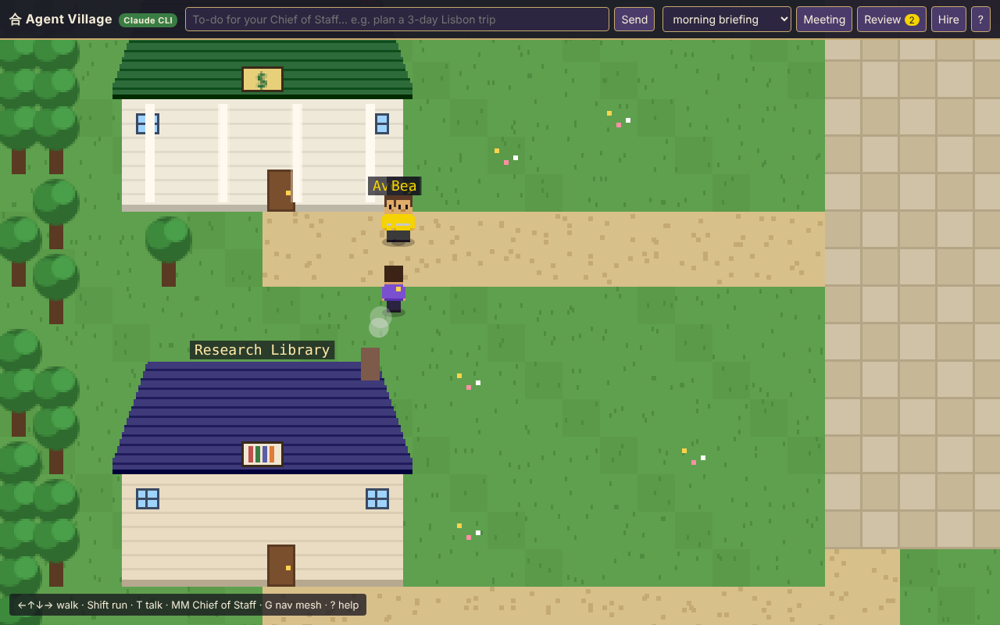
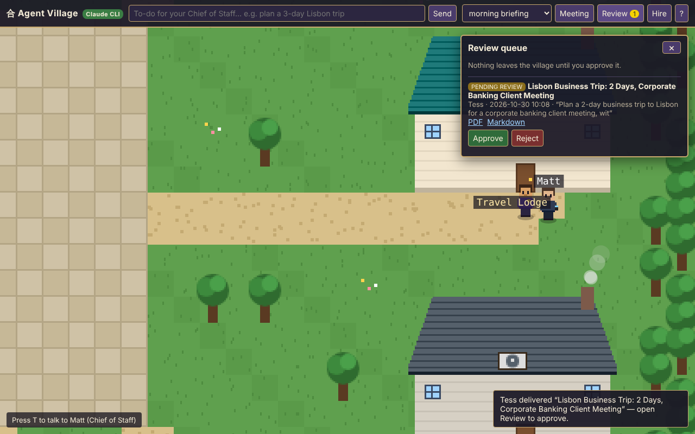

<div align="center">

# 合 &nbsp;aikido

### AI-native knowledge &amp; decision operations for startup teams

*Treat prompts as software artifacts — modular Markdown, Jinja2 templates,*
*JSON contracts, build-time validation, and flat artifact output.*

[Getting started](docs/getting-started.html) ·
[Commands](docs/commands.html) ·
[Concepts](docs/concepts.html) ·
[Structure](docs/structure.html) ·
[Documentation site](docs/index.html)

`Python 3.10+` &nbsp;•&nbsp; `Typer` &nbsp;•&nbsp; `Jinja2` &nbsp;•&nbsp; `Pydantic` &nbsp;•&nbsp; `MIT`

</div>

---

You capture what happens day to day, aggregate it weekly, and *transpile*
reusable AI agents (system prompts) from your own knowledge base — every input
and output a plain file you can diff, review, and commit. No database, no hidden
state.

```
  daily logs  ──▶  weekly rollups  ──▶  [ template + contract ]  ──▶  06_dist/*.md
   (capture)        (aggregate)              (transpile)              (flat artifact)
```

📖 **Documentation:** the [`docs/`](docs/) directory is a dependency-free static
site (welcome page, getting started, command reference, concepts). The command
reference is *generated from the live CLI* by `scripts/gen_docs.py`, so it never
drifts from the code. Serve it locally with `python -m http.server -d docs`, or
publish it via GitHub Pages (Settings → Pages → deploy from branch, `/docs`
folder).

## Install

```bash
pip install -e .
aikido --help
```

## Quickstart

```bash
aikido init my-company          # scaffold the knowledge tree + git repo
cd my-company
aikido daily                    # guided capture of today
aikido weekly                   # aggregate the week + build agents
aikido build_agent founder_weekly_review --week 2026-W29
```

The built artifact lands in `06_dist/founder_weekly_review_2026-W29.md` — a flat,
self-contained Markdown system prompt with all includes resolved and its
contract validated.

## Directory layout

```
00_control_plane/     founder identity, tone, safety guardrails
01_weekly_cadence/    per-week daily logs + aggregated summaries
02_domain_knowledge/  product + go-to-market knowledge
03_support_tickets/   support themes
04_contracts/         JSON contracts (definition of done, constraints)
05_agents/            Jinja2 prompt templates (*.prompt.md)
06_dist/              built flat-Markdown artifacts
07_archive/           compressed old weeks
```

## Commands

| Command | What it does |
| --- | --- |
| `aikido init <name>` | Scaffold dirs, default templates/contracts/control plane, git init |
| `aikido daily` | Interactive daily capture → `01_weekly_cadence/{week}/{date}_daily.md` |
| `aikido weekly` | Aggregate daily logs into decisions/blockers/signals/summary, then build agents |
| `aikido build_agent <agent>` | Transpile one template + contract → flat Markdown in `06_dist/` |
| `aikido update <path>` | Update domain knowledge or support themes |
| `aikido sync <source>` | Pull from Notion/Linear/Slack/Stripe into the knowledge base |
| `aikido archive <weeks>` | Compress old weekly files |
| `aikido onboard <name> <role>` | Generate an onboarding brief |
| `aikido investor` | Generate an investor update |
| `aikido dashboard` | Knowledge-system health dashboard |
| `aikido validate` | Check broken includes, undefined variables, contract mismatches, stale files |
| `aikido config` | Manage `.aikido/config.yaml` |
| `aikido village` | Open the Agent Village — a local RPG town where your AI agents live and work |

## The transpiler

`AikidoTranspiler` runs a staged pipeline for each agent:

1. **pre_transpile** — every static ``/`` target exists;
   every contract output id is referenced in the template.
2. **transpile** — render the Jinja2 template against the contract + variables.
3. **post_transpile** — the rendered output satisfies contract constraints
   (word counts, no generic filler).

On success the artifact is written to `06_dist/{agent}_{week}.md`.

## Agent Village

```bash
aikido village            # opens http://127.0.0.1:8765/
```

A top-down 16-bit town that runs locally in your browser. Ten buildings sit
around a town square with a fountain. Your **Chief of Staff** (Matt by default)
follows you around, takes to-dos from the toolbar and routes each one to one of
seven **directors**:

| Director | House | Domain |
| --- | --- | --- |
| Iris | Inbox House | email and calendar (drafts only) |
| Cole | Content Studio | video and social scripts (never publishes) |
| Penny | Money House | budgets, cash flow, treasury and covenant checks (never moves money) |
| Reed | Research Library | research reports |
| Tess | Travel Lodge | itineraries (never books) |
| Ezra | Code Workshop | specs, scripts, reviews |
| Kai | Knowledge Archive | this aikido knowledge base |

- **No API keys.** Every agent thinks through your local `claude` CLI in
  headless mode, on your Claude subscription. The Chief of Staff and directors
  run Opus, directors can escalate a complex edge-case to an advisor model, and
  hired interns run Sonnet. Without the CLI the village runs offline with
  placeholder replies.
- **Memory.** Each agent has `village/agents/<id>/identity.md` and a persistent
  `notes.md`. When two interns bump into each other in town, they swap status
  and both write it down.
- **Deliverables.** Finished work is saved as Markdown and PDF and lands in the
  **Review** queue. Nothing is acted on until you approve it.
- **Controls.** Arrow keys or WASD to walk, Shift to run, walk into a door to go
  inside. `T` talks to whoever is next to you, double-tap `M` talks to the
  Chief of Staff from anywhere ("call Penny" makes Penny walk over), **Meeting**
  gathers every director at the Town Hall table, and `G` shows the navigation
  mesh.
- **Guardrails, enforced in code.** Each agent call is limited to file tools in
  the agent's own folder (`--tools`, `--allowedTools`,
  `--permission-mode dontAsk`). Connector tools whose names suggest sending,
  posting, paying, trading, sharing or deleting are never granted. Interns only
  spawn after you interview and approve them (`approved_by_human`). The server
  binds to `127.0.0.1` and refuses cross-origin requests.

To give Iris your mailbox, add the draft-only connector tool names to
`village/village.json`:

```json
{ "connector_tools": { "inbox": ["mcp__Gmail__create_draft", "mcp__Gmail__search_threads"] } }
```

Everything is drawn procedurally on a canvas, so there are no image assets and
no image-generation credits to spend.




## Development

```bash
pip install -e ".[dev]"
pytest tests/
```

### Transcript → daily webhook (Azure Functions)

`azure/` is a deployable webhook that turns each Microsoft Teams meeting
transcript (or a manual paste) into a scope-disciplined daily and opens it as a
pull request — using the `daily_from_transcript` agent + Claude. See
[`azure/README.md`](azure/README.md) for deploy + Power Automate wiring.

### Regenerating the command reference

`docs/commands.html` is a build artifact — it's rendered through aikido's own
transpiler from the live CLI plus curated prose in `docs/commands.meta.json`.
After adding or changing a command, regenerate it:

```bash
python scripts/gen_docs.py
```

The generator warns if a CLI command is missing from `commands.meta.json` (or
vice versa), so the docs can't silently fall out of sync with the code.

## License

MIT
